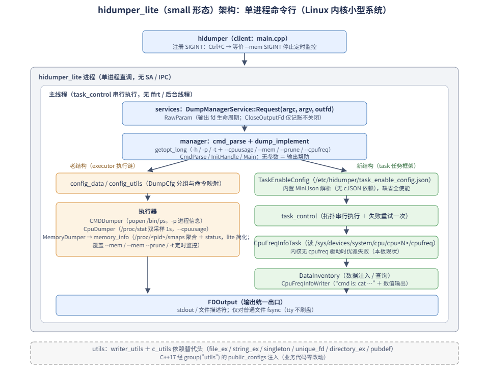
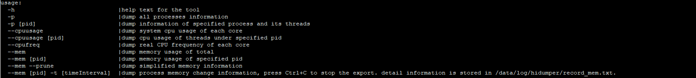

# hiviewdfx_hidumper_lite

-   [Introduction](#Introduction)
-   [Directory Structure](#Directory Structure)
-   [Use of hidumper_lite](#Use of hidumper_lite)
-   [Use of hidumper (small system)](#Use of hidumper (small system))
-   [System Interface](#System Interface)
-   [Rewrite interface](#Rewrite interface)
-   [Related warehouses](#Related warehouses)

## Introduction

The hidumper_lite provides dump interfaces in the LiteOS_M system to help developers export fault logs, memory, and CPU information.

Meanwhile, on small systems with the Linux kernel, hidumper_lite provides the hidumper command line tool: hidumper is a single-process command line program that helps developers export CPU, memory, and process information, with output formats aligned with the standard-system hidumper.

## Directory Structure

The source of Hiview code directory structure is as follows::

```
/base/hiviewdfx/hidumper_lite.
├── lite
    └── hidumper.c                          #AT命令处理过程
├── mini
    ├── hidumper_adapter.c                  #hidumper功能函数适配层
    ├── hidumper_core.c                     #hidumper核心层
    └── interfaces                          #公共接口文件
└── small                                   #small system (Linux kernel) implementation
    ├── client                              #command line entry
    ├── frameworks                          #dump framework (config chain + executor chain)
    ├── interfaces                          #inner interface files
    ├── services                            #service layer
    ├── test                                #unit test cases
    └── utils                               #common utilities (lite-system dependency shims)
```

## Use of hidumper_lite

The hidumper_lite command is used to query data in the liteOS_M. The commands are registered in the product-side AT command table, which invokes the entry function `at_hidumper` (see [System Interface](#System Interface)). The mini form provides a platform adaptation layer: `hidumper_adapter.c` supplies a set of WEAK default implementations and registers them automatically at system startup (`CORE_INIT_PRI`); products override the functions listed in [Rewrite interface](#Rewrite interface) to feed in real platform data.

Parameter:
  |  Format  | Meaning  |
  | -------- | -------- |
  | AT+HIDUMPER= | Displays the CPU, memory, and all task usage information |
  | AT+HIDUMPER=-dc | Displays CPU usage information |
  | AT+HIDUMPER=-dm | Displays memory usage information |
  | AT+HIDUMPER=-df | Print the last fault log information |
  | AT+HIDUMPER=-dt | Print all task information |
  | AT+HIDUMPER=-h | Print the help information |
  | AT+HIDUMPER=-ikc | Injecting faults into the kernel |
  | AT+HIDUMPER=-m | Prints all memory data in hexadecimal format |
  | AT+HIDUMPER=-m,memstart,memsize | Prints the data of a specific memory area in hexadecimal format. Two parameters, 
                                      memstart: Memory start address. memsize: memory size |

Notes: `-ikc`, `-m`, and `-m,memstart,memsize` are supported only in OHOS_DEBUG builds (otherwise Unsupported is printed); `-m,filepath` and `-m,memstart,memsize,filepath` are reserved formats and print Unsupported in the current version; unrecognized parameters print the help information; if no adapter has been registered, `at_hidumper` returns 1 (under normal startup the adaptation layer is auto-registered, so this does not occur).

In addition, the mini form provides a shell-style entry `OH_Hidumper_StartCmd` (see [System Interface](#System Interface)), which accepts `-dc/-dm/-dt/-h` and long aliases `-cpuusage/--mem/-p/--help`.

## Use of hidumper (small system)

On small systems with the Linux kernel, HiDumper provides a unified system information collection tool for development and test personnel to analyze and locate faults. On small systems, hidumper is a single-process command line program that executes the dump flow locally and writes to standard output. HiDumper consists of the following modules:

-   hidumper, the executable program of the HiDumper tool, which receives user input and executes the dump flow directly in a single process.
-   DumpManager/DumpImplement, the manager of HiDumper, which provides functions such as information classification, command request distribution, and information collection.
-   Dumpers, exporters of various information, including process information export, CPU usage export, CPU frequency export (cat kernel cpufreq nodes), and memory usage export.
-   Output, content output, mainly FdOutput which outputs to standard output or a file descriptor.

**Figure 1**  Architecture of hidumper_lite (small system)



Running hidumper without arguments prints the help text only (full-system dump is not supported).

The procedure is as follows:

1.  Access the device CLI, and run the **hidumper -h** command to obtain the help information, which includes basic information and function syntax.

    ```
    hidumper -h
    ```

**Figure 2**  Help information output of hidumper -h



2.  Run the **hidumper -p** command to obtain process information, including the list and information of processes and threads.

    ```
    hidumper -p
    ```

3.  Run the **hidumper -p 1024** command to obtain information about the process whose PID is 1024.

    ```
    hidumper -p 1024
    ```

4.  Run the **hidumper --cpuusage** command to obtain the CPU usage information of the system. The output includes the load average, the sampling time window, the total CPU usage (Total), and the CPU usage details of each process (Details of Processes).

    ```
    hidumper --cpuusage
    ```

5.  Run the **hidumper --cpuusage 1024** command to obtain the CPU usage information of the process whose PID is 1024.

    ```
    hidumper --cpuusage 1024
    ```

6.  Run the **hidumper --cpufreq** command to obtain the actual operating frequency of each CPU core. The command depends on the kernel cpufreq framework and driver (reading nodes under `/sys/devices/system/cpu/cpu<N>/cpufreq/`); if the kernel does not provide them, the command exits gracefully.

    ```
    hidumper --cpufreq
    ```

7.  Run the **hidumper --mem** command to obtain the memory usage of the system.

    ```
    hidumper --mem
    ```

8.  Run the **hidumper --mem 1024** command to obtain the memory usage of the process whose PID is 1024.

    ```
    hidumper --mem 1024
    ```

9.  Run the **hidumper --mem --prune** command to export simplified memory information quickly.

    ```
    hidumper --mem --prune
    ```

10. Run the **hidumper --mem 1 -t 1** command to collect and print the memory change information of the PID at intervals. Press Ctrl+C to stop the export, and the detail information is stored in /data/log/hidumper/record_mem.txt (a writable /data partition is required).

    ```
    hidumper --mem 1 -t 1
    ```

## System Interface

### at_hidumper

```
unsigned int at_hidumper(unsigned int argc, const char **argv);
```

AT instruction processing function injected into the system

- Parameter:
  | Member | Type | Required | Description 
  | -------- | -------- | -------- | -------- |
  | argc | unsigned int | Y | number of Parameter |
  | argv | const char** | Y | content of Parameter |

- Return value: 0 when the adaptation layer has been registered; otherwise a prompt is printed and 1 is returned.

### OH_Hidumper_StartCmd

```
int OH_Hidumper_StartCmd(int argc, const char *args[], char **out);
```

Shell-style command entry of the mini form, implemented with direct LOS_* kernel calls without the adaptation layer. A leading '-' prefix of each parameter is ignored automatically; `-dc/-dm/-dt/-h` and the long aliases `-cpuusage/--mem/-p/--help` are accepted; when no valid parameter is present, all information (CPU, memory, tasks) is exported.

- Parameter:
  | Member | Type | Required | Description |
  | -------- | -------- | -------- | -------- |
  | argc | int | Y | number of parameters |
  | args | const char*[] | Y | content of parameters |
  | out | char** | N | reserved output pointer, currently unused |

- Return value: 0 on success; -1 with the help text printed when the command is not recognized.

## Rewrite interface

For details about the example, see the rewriting of the hi3861 chip. The corresponding position is as follows device/soc/hisilicon/hi3861v100/sdk_liteos/components/at/src/hidumper_adapter_impl.c

The following functions are : that need to be rewritten on different chips.

### DumpSysInfo

```
int DumpSysInfo(void);
```

Rewrites the function of printing system information. This function prints the system information of the current device.

### DumpCpuUsage

```
int DumpCpuUsage(void);
```

Rewrites the function for printing CPU usage information. This function prints the CPU usage of the current device.

### DumpMemUsage

```
int DumpMemUsage(void);
```

Rewrites the function for printing memory usage information. This function prints the memory usage of the current device.

### DumpTaskInfo

```
int DumpTaskInfo(void);
```

Rewrite the function of printing all task information of the system. This function prints all task information in the system.

### DumpFaultLog

```
int DumpFaultLog(void);
```

Rewrites the function for printing exception logs. This function prints the last saved log information.

### DumpMemRegion

```
int DumpMemRegion(unsigned long long addr, unsigned long long size)
```

Overwrites the function of printing memory data in a specified area. This function prints the data of the memory area of the total size starting from addr.

- Parameter:
  |Parameter name|Type|Mandatory|Description 
  | -------- | -------- | -------- | -------- |
  | addr | unsigned long long | Y | Start address of the memory to be queried |
  | size | unsigned long long | Y | Internal size to be queried |

### DumpAllMem

```
int DumpAllMem(void); 
```

Overwrites the function of printing all memory data. This function can print all memory data.

### PlatformHiDumperIinit

```
int PlatformHiDumperIinit(void); 
```

Rewrites the platform hidumper initialization function. This function initializes features such as the at command of HiDumper based on different platforms.

## Related warehouses

[Subsystem of DFX](https://gitee.com/openharmony/docs/blob/master/zh-cn/readme/DFX%E5%AD%90%E7%B3%BB%E7%BB%9F.md)

**hiviewdfx\_hidumper_lite**

[hiviewdfx\_blackbox](https://gitee.com/openharmony/hiviewdfx_blackbox/blob/master/README_zh.md)

[hiviewdfx\_hilog\_lite](https://gitee.com/openharmony/hiviewdfx_hilog_lite/blob/master/README_zh.md)

[hiviewdfx\_hievent\_lite](https://gitee.com/openharmony/hiviewdfx_hievent_lite/blob/master/README_zh.md)

[hiviewdfx\_hiview\_lite](https://gitee.com/openharmony/hiviewdfx_hiview_lite/blob/master/README_zh.md)
