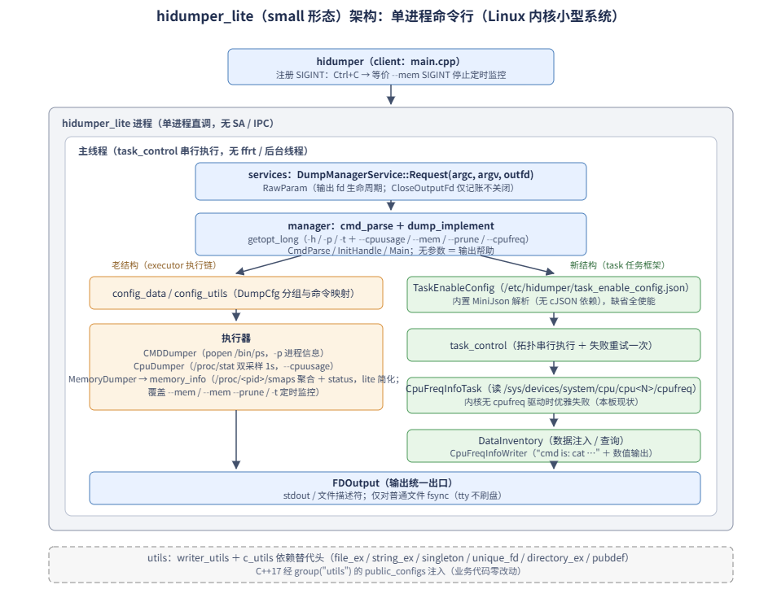

# hiviewdfx_hidumper_lite

-   [简介](#简介)
-   [目录](#目录)
-   [hidumper_lite（mini系统）的使用](#hidumper_lite（mini系统）的使用)
-   [hidumper（small系统）的使用](#hidumper（small系统）的使用)
-   [接口定义](#接口定义)
-   [相关仓](#相关仓)

## 简介

hidumper_lite面向轻量设备提供系统信息导出能力，包含两种形态：

-   mini形态：LiteOS-M内核上的内核态实现，基于LOS_系列内核接口（LOS_TaskInfoGet、LOS_MemInfoGet、LOS_History*CpuUsage等）导出CPU、内存和任务信息，适用于提供LiteOS内核（如ws63v100 SDK的LiteOS内核）的mini系统产品。
-   small形态：Linux内核小型系统上的hidumper命令行工具。小型系统裁剪了SA/IPC框架，hidumper为单进程命令行程序，帮助开发者导出CPU、内存、进程等信息，输出格式与标准系统hidumper保持一致。

## 目录

源代码目录结构如下：

```
/base/hiviewdfx/hidumper_lite
├── mini                                    #mini系统（LiteOS-M内核）实现
│   ├── hidumper.c                          #内核态实现（CPU/内存/任务信息导出）
│   └── hidumper.h                          #对外入口声明
└── small                                   #small系统（Linux内核）实现
    ├── client                              #命令行入口
    ├── frameworks                          #dump框架（executor执行链与task任务框架）
    ├── interfaces                          #内部接口文件
    ├── services                            #服务层（单进程直调，无SA/IPC）
    ├── test                                #单元测试用例
    └── utils                               #公共能力（含轻量系统依赖替代）
```

## hidumper_lite（mini系统）的使用

mini形态通过AT命令进行数据查询，命令由产品侧AT命令表注册并调用入口函数`DealHidumperCmd`（见[接口定义](#接口定义)）。

- 参数：
  | 命令格式 | 命令含义 |
  | -------- | -------- |
  | AT+HIDUMPER= | 打印出CPU、内存和全部的task使用信息 |
  | AT+HIDUMPER=-dc | 打印出CPU使用信息（各时间窗的系统与任务占用） |
  | AT+HIDUMPER=-dm | 打印出内存使用信息（内存池使用量、空闲量、水线等） |
  | AT+HIDUMPER=-dt | 打印出全部task信息（优先级、栈使用、事件、信号量等） |
  | AT+HIDUMPER=-h | 打印出帮助信息 |

命令参数同时支持长格式别名：`-cpuusage`等价于`-dc`，`--mem`等价于`-dm`，`-p`等价于`-dt`，`-help`等价于`-h`。

## hidumper（small系统）的使用

Linux内核的小型系统上，hidumper为开发、测试人员提供统一的系统信息获取工具，帮助使用者分析、定位问题。小型系统裁剪了SA/IPC框架，hidumper为单进程命令行程序，直接在本地执行导出流程并输出到标准输出。主要包括以下几个模块：

-   hidumper，hidumper工具的可执行程序，接收用户输入，单进程直接执行导出流程。
-   DumpManager/DumpImplement，系统信息导出工具管理者，提供信息分类、命令请求分发和信息获取方法的管理。
-   Dumpers，各类信息的导出器。主要包括进程信息导出、CPU使用率导出、CPU频率导出、内存使用导出等。
-   Output，内容输出，主要包括向标准输出或文件描述符输出的FdOutput。

**图1**  hidumper_lite架构图



不带参数执行hidumper时仅打印帮助信息（不支持全量dump）。

具体步骤如下：

1.  进入设备命令行，输入hidumper -h获取基本信息介绍，功能语法介绍。

    ```
    hidumper -h
    ```

2.  运行  **hidumper -p**  命令获取进程信息，包括进程、线程的列表和信息。

    ```
    hidumper -p
    ```

3.  运行  **hidumper -p 1024**  命令获取pid为1024的进程信息。

    ```
    hidumper -p 1024
    ```

4.  运行  **hidumper --cpuusage**  命令获取系统CPU的使用信息，输出包括负载均值（Load average）、采样时间窗、整机CPU使用率（Total）以及各进程CPU使用明细（Details of Processes）。

    ```
    hidumper --cpuusage
    ```

5.  运行  **hidumper --cpuusage 1024**  命令获取pid为1024进程的CPU使用信息。

    ```
    hidumper --cpuusage 1024
    ```

6.  运行  **hidumper --cpufreq**  命令获取每一个CPU核实际运行的频率。该命令依赖内核cpufreq框架及cpufreq驱动（读取`/sys/devices/system/cpu/cpu<N>/cpufreq/`下的节点）；内核未提供时命令优雅退出。

    ```
    hidumper --cpufreq
    ```

7.  运行  **hidumper --mem**  命令获取系统整体内存使用信息。

    ```
    hidumper --mem
    ```

8.  运行  **hidumper --mem 1024**  命令获取pid为1024进程的内存使用信息。

    ```
    hidumper --mem 1024
    ```

9.  运行  **hidumper --mem --prune**  命令快速导出精简的内存信息。

    ```
    hidumper --mem --prune
    ```

10. 运行  **hidumper --mem 1 -t 1**  命令按时间间隔统计并打印pid的内存变化信息；按Ctrl+C停止导出，明细信息存储在/data/log/hidumper/record_mem.txt（需要设备存在可写的/data分区）。

    ```
    hidumper --mem 1 -t 1
    ```

**图2**  small系统板侧单元测试运行结果（13个用例全部通过）


## 接口定义

### DealHidumperCmd

```
int DealHidumperCmd(int argc, char *args[]);
```

mini形态的命令处理入口，由产品侧AT命令表或内核shell注册调用。

- 参数：
  | 成员 | 类型 | 必填 | 说明 |
  | -------- | -------- | -------- | -------- |
  | argc | int | 是 | 输入参数的个数。 |
  | args | char*[] | 是 | 输入参数的内容，参数前的'-'前缀会被自动忽略。 |

- 返回值：命令执行成功返回0；命令无法识别时打印帮助信息并返回-1；无有效参数时导出全部信息（CPU、内存、任务）。

## 相关仓

[DFX子系统](https://gitee.com/openharmony/docs/blob/master/zh-cn/readme/DFX%E5%AD%90%E7%B3%BB%E7%B3%BB%E7%BB%9F.md)

**hiviewdfx\_hidumper\_lite**

[hiviewdfx\_blackbox](https://gitee.com/openharmony/hiviewdfx_blackbox/blob/master/README_zh.md)

[hiviewdfx\_hilog\_lite](https://gitee.com/openharmony/hiviewdfx_hilog_lite/blob/master/README_zh.md)

[hiviewdfx\_hievent\_lite](https://gitee.com/openharmony/hiviewdfx_hievent_lite/blob/master/README_zh.md)

[hiviewdfx\_hiview\_lite](https://gitee.com/openharmony/hiviewdfx_hiview_lite/blob/master/README_zh.md)
